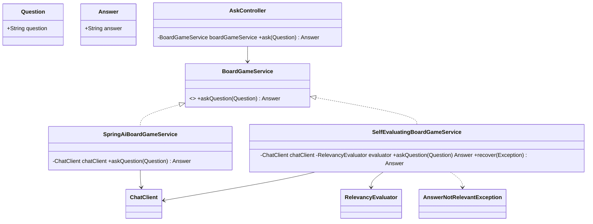

# Board Game Buddy — Praktikum Spring AI Chapter 1–2

Implementasi mengikuti *Spring AI in Action*, Chapter 1 **Getting started with Spring AI** dan Chapter 2 **Evaluating generated responses**, sesuai brief tugas.

## Cakupan

- Chapter 1: REST API `POST /ask`, `ChatClient`, konfigurasi OpenAI-compatible melalui Naraya, dan WireMock.
- Chapter 2: `RelevancyEvaluator`, `FactCheckingEvaluator`, serta service self-evaluating dengan retry dan fallback.
- Tidak termasuk frontend, database, RAG, memory, tools, atau fitur Chapter 3+.

## Struktur kode

| Kelas | Peran |
|---|---|
| `Question` | Record request dengan field `question`. |
| `Answer` | Record response dengan field `answer`. |
| `BoardGameService` | Kontrak method `askQuestion`. |
| `SpringAiBoardGameService` | Implementasi Chapter 1 menggunakan `ChatClient`. |
| `AskController` | Endpoint `POST /ask`. |
| `SelfEvaluatingBoardGameService` | Implementasi Chapter 2 dengan evaluasi relevansi, retry, dan fallback. |
| `AnswerNotRelevantException` | Exception ketika jawaban tidak relevan. |

## Class diagram



## Persiapan

- Java 17 atau lebih tinggi. Proyek ini diuji dengan Java 23.
- Gradle Wrapper.
- Kredensial Naraya di `~/.pi/agent/models.json` untuk menjalankan model live.

### Konfigurasi Naraya

Starter `spring-ai-starter-model-openai` tetap digunakan sesuai bagian OpenAI Compatibility (§1.2). Konfigurasi pi untuk provider `naraya` menyebut endpoint `https://router.bynara.id/v1`, API `openai-completions`, dan model `gpt-6-luna`. URL dan ID model tersebut diatur di `src/main/resources/application.properties`; hanya API key yang tetap rahasia.

Task Gradle `bootRun` dan `liveAiTest` membaca `providers.naraya.apiKey` dari `~/.pi/agent/models.json` dan meneruskannya ke proses Java tanpa mencetak atau menyimpannya di repository. Prioritas diberikan pada environment variable `NARAYA_API_KEY` jika sudah diisi. Jika key di `models.json` berupa referensi `$VAR` atau `!command`, set `NARAYA_API_KEY` sendiri. Hentikan aplikasi lama dengan `Ctrl+C` sebelum memulai ulang; proses lama tidak menerima perubahan konfigurasi. Jangan perlihatkan isi `models.json` dalam screenshot/video dan jangan unggah ke GitHub.

## Menjalankan aplikasi

```powershell
cd board-game-buddy
./gradlew bootRun
```

Di terminal PowerShell lain, gunakan perintah bawaan PowerShell (tidak perlu `curl.exe`):

```powershell
Invoke-RestMethod -Uri "http://localhost:8080/ask" `
  -Method Post `
  -ContentType "application/json" `
  -Body '{"question":"Why is the sky blue?"}'
```

Respons berupa JSON:

```json
{"answer":"...jawaban dari model..."}
```

Model aktif: `gpt-6-luna` melalui Naraya. Task `bootRun` otomatis mengambil API key dari provider `naraya` di `~/.pi/agent/models.json`; jika tidak tersedia, set `NARAYA_API_KEY` sendiri sebelum menjalankan Gradle.

## Pengujian

### Chapter 1: tes deterministik WireMock

Tes ini tidak membutuhkan konfigurasi Naraya dan tidak memanggil Naraya/OpenAI. URL, model, dan API key tes di-override secara lokal. Respons OpenAI-compatible diganti fixture `src/test/resources/test-openai-response.json` yang berisi `Paris`.

```powershell
./gradlew test
```

Hasil terverifikasi: **BUILD SUCCESSFUL**, 3 tes lulus (context, service WireMock, endpoint WireMock).

### Chapter 2: evaluator terhadap provider AI sungguhan

Tes ini memanggil model AI dan evaluator melalui Naraya sehingga dapat memakai kuota/biaya akun Naraya. Gradle meneruskan key dari konfigurasi pi:

```powershell
./gradlew liveAiTest
```

Tes yang dijalankan:

1. `evaluateRelevancy` — memastikan jawaban relevan dengan pertanyaan.
2. `evaluateFactualAccuracy` — memastikan jawaban dinilai faktual.

### Mode runtime self-evaluating

Service Chapter 1 aktif secara default. Untuk menjalankan service Chapter 2 yang melakukan evaluasi relevansi saat runtime:

```powershell
./gradlew bootRun --args='--spring.profiles.active=self-evaluating'
```

Jika jawaban tidak relevan, Spring Retry mengulang sampai batas default, kemudian `@Recover` mengembalikan pesan fallback.

## Pemetaan ke buku

- Listing 1.1: dependensi Gradle dan BOM Spring AI.
- Listing 1.2: `SpringAiBoardGameService`.
- Listing 1.3: `AskController`.
- Listing 1.4: `SpringAiBoardGameServiceWireMockTests` dan fixture JSON.
- Listing 2.1: `SpringAiBoardGameServiceTests` dengan relevancy dan factual evaluation.
- Listing 2.2: `SelfEvaluatingBoardGameService`, exception, retry, dan recover.

## Bukti praktikum yang perlu direkam mahasiswa

1. Tampilkan struktur project dan `build.gradle`.
2. Tampilkan environment variable API key tanpa memperlihatkan nilainya.
3. Jalankan `./gradlew test` dan tunjukkan hasil sukses.
4. Jalankan aplikasi dan kirim `POST /ask`.
5. Tampilkan kode Chapter 2 dan jalankan `./gradlew liveAiTest`.
6. Publikasikan repository secara public/private sesuai instruksi dosen; pastikan API key tidak ikut ter-commit.
